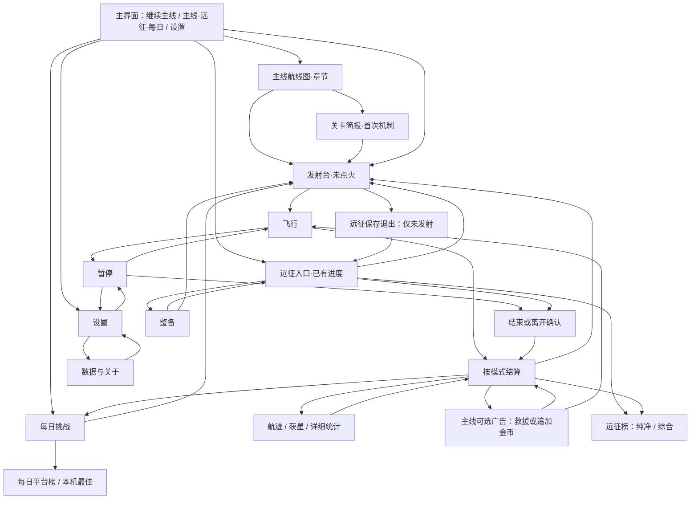

# 新旧交互流程与完整导航

## 2026-10-23 最新确认：手机竖屏优先

以手机竖屏触控为首发设计与验收基准（390×844，覆盖360×640、430×932），桌面兼容。横屏仅作兼容检查，不再作为主设计方向或首发P0门槛。下文历史横屏布局、双列示意及横屏任务要求均以本条为准。

菜单遵循手机操作：内容纵向滚动，每页一个明确主动作，主要继续/出发/重试位于内容下方的拇指可达区域；长页使用不遮挡内容的底部操作区，保留系统底部安全距离。返回固定在左上且逐层返回，危险动作与继续分开，广告作为次级可选操作。目标至少48×48 CSS像素，不依赖悬停、精细点按或横向拖动。现有飞行HUD、双指按钮与飞行镜头保持；不能把菜单尺寸规范套用成HUD改版。

## 2026-10-23 用户评审更新：保留当前飞行 HUD

用户明确认可现有飞行HUD。后续保留dev.25的遥测项目、信息层级、位置、视觉样式、操作按钮及提示方式，不实施本轮提出的HUD重排、精简或新布局。默认不调整飞行镜头。菜单、选关、远征、暂停、结算与设置继续按方案评审。

横屏适配和四边安全区仍须验证，但不能以此擅自替换已认可的HUD；若实测发现必须调整HUD或镜头才能适配的冲突，单独呈现问题和最小改动方案。触控释放、模态输入隔离、传感器异常及返回路径可以继续审查；具体实现仍在后续阶段。

2026-10-23 · 设计提案，尚未实施。点击数指一次有意点按/键盘激活，不计按住推进、滚动、广告时长和加载。首次新机制简报另计。

## 高频操作对比

|玩家任务与起点|当前流程（代码推导）|建议流程|操作数变化|
|---|---|---|---|
|新玩家首页到发射台|开始航行（新档默认第2关）→说明→准备起飞|启程·第1关→简短初始教学→进入发射台|2→2，修正起点、减少阅读|
|熟悉航线首页再次开始|继续→说明→准备|挑战第N关→发射台；任务摘要就地展开|2→1|
|主线成功后继续已解锁熟悉航线|航迹→查看结算→下一关→准备起飞|同屏结算→下一关|3→1；首次新机制时2|
|失败重试主线|航迹→立即重试|失败摘要→重试本关|1→1，不为整齐增加点击|
|主线失败请求广告救援|航迹→原因/结算→广告救援|失败摘要→观看广告救援|2→1，不自动播放|
|成功双倍奖励|航迹→结算→广告|结算同屏→广告再加X|2→1；基础奖励零点击自动入账|
|主线下一关需金币且余额足够|航迹→结算→解锁→下一关→准备|结算→解锁并继续→确认花费→发射台|4→2；不省略消费确认，首次新机制另+1|
|首页开始每日|单关挑战→每日→滚动开始|首页每日→开始|3→2，不含首次榜单授权|
|远征站点整备后继续|整备→某项→返回远征→出航|整备→某项→继续出航|4→3；首次失去纯净资格额外确认一次|
|部分远征死亡后看综合榜|查看结算→排行榜（纯净）→切换综合|远征结算→综合榜|3→1；提交仍自愿|
|飞行时改设置再继续|设置→调整→完成→暂停继续|暂停→设置→调整→返回暂停→继续|可能多1步，明确暂停与输入归属优先；支持已有快捷设置入口时保持原成本|

## 页面结构图

箭头表示可达性，不代表所有模式都拥有全部动作；下面模式表是权威约束。设置返回调用它的页面，不按图中某一个固定父节点返回。

## 模式与状态约束

|状态|主线|每日|远征|
|---|---|---|---|
|发射前|开始，返回原关卡/首页|开始，返回每日|出航，整备，保存退出；不重复补给|
|飞行暂停|继续，重新开始，返回来源，设置|继续，重新开始，返回每日，设置|继续，结束并结算（确认），设置；无重试/保存退出|
|失败|原因/建议，免费重试，符合条件时广告救援|原因/建议，免费重试；无救援|当即结算，原因/累计数据；查看综合榜，新开远征；无复活|
|成功|三任务、金币已入账、下一关或解锁、可选双倍|本机最佳与真实提交状态，再挑战；无金币|前29关立即保存并进入停靠页，保留统计摘要；第30关终局结算|
|排行榜|原关卡成绩不伪装在线|既有同意后自动提交策略|只有已结算符合资格的成绩，明确自愿提交；两榜最佳独立|
|关闭/中断|现有重开规则|现有单次挑战规则|未发射保留；飞行中结束；异常不可验证仅本机结算|

## 统一返回与模态规则

1. 页面栈保留来源、列表滚动、筛选和焦点。Back/Esc退一层；飞行中Esc打开暂停；不直接变成回首页。
2. 设置从主菜单开，返回主菜单；从暂停开，返回暂停；从整备开，返回原整备页。关闭设置不自动点火或隐式恢复飞行。
3. 模态确认“取消”返回发起处；不能取消后跳到别的首页。危险确认默认焦点给取消/继续航行。
4. 飞行模式只允许顶部UI层接收输入；打开菜单清除全部按键与触点，关菜单后必须重新按下才点火。
5. 广告、外部榜单和权限弹窗返回，回到原操作页并显示明确结果；不自动重试、不重复发奖。
6. 宿主系统返回事件只有在官方支持时才能接入；未能拦截的关闭行为仍由现有存档状态机兜底。不能承诺拦住所有系统手势。

## 关键分支

- **下一关不足金币**：显示差额、两星免费路径与“再挑战本关”。有尚未领取的双倍机会才显示广告追加，不暗示广告必需。
- **首次付费/广告整备**：确认页写明本次从纯净资格转为仅综合资格，展示价格与结果；取消不扣币/不请求广告。已失去资格后无需再重复警告。
- **远征死亡**：先固化结算，再显示页面；保存失败只提供“重试保存”，不是“重试航行”。0关失败无合格上榜成绩，不能显示可提交。
- **远征完结**：庆祝画面保留黑洞与研究站；30/30、累计时间、资格和双榜入口同屏，终局演出可跳过，不阻止保存。
- **过期每日**：明确本局仅本机/需新挑战，禁止把旧局显示成新日已提交。
- **所有成功页面**：先业务提交、再展示已入账；重绘与返回只读交易回执，绝不再次结算。
